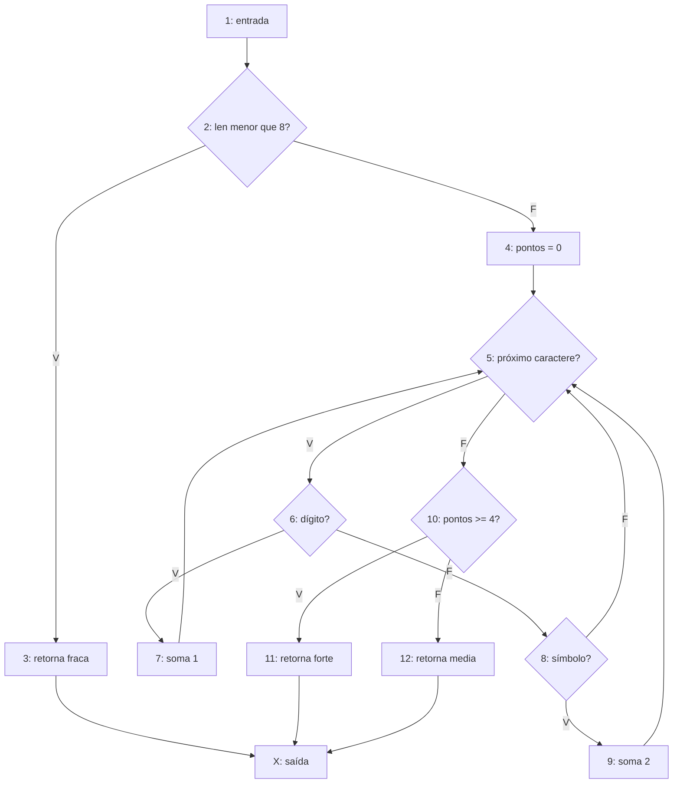

# Laboratório 8 — Critérios de Cobertura Estrutural

CC8550 — Simulação e Teste de Software · Prof. Luciano Rossi  
Departamento de Ciência da Computação · Centro Universitário FEI  
2º semestre de 2026

Aluno: ____________________________________  RA: __________________

## Execução

Extraia o ZIP e abra um terminal na pasta `lab08`.

Linux:
```bash
python3 -m venv .venv
source .venv/bin/activate
pip install -r requirements.txt
pytest -q
pytest -q --cov=senha --cov=embarque --cov=preco --cov-branch --cov-report=term-missing
```

Windows (PowerShell):
```powershell
python -m venv .venv
.venv\Scripts\Activate.ps1
pip install -r requirements.txt
pytest -q
pytest -q --cov=senha --cov=embarque --cov=preco --cov-branch --cov-report=term-missing
```

Os arquivos `senha.py`, `embarque.py` e `preco.py` contêm a versão final.
`originais_embarque.py` e `originais_preco.py` preservam os defeitos.
A pasta `experimentos` fica fora da coleta padrão: seus testes devem falhar
quando expõem os defeitos originais. Isso permite reproduzir a investigação
sem deixar a suíte final com falhas esperadas ocultas por `xfail`.

## Exercício 1 — Força da senha

### a) GFC e complexidade ciclomática

O desenho também está em `GFC.svg`. Os números correspondem às linhas do enunciado;
1 é a entrada e X é uma saída comum. O nó 5 representa o teste implícito do `for`.



Há N = 13 nós e E = 17 arestas, em um componente conectado (P = 1).
Logo, V(G) = E − N + 2P = 17 − 13 + 2 = **6**.
Há cinco decisões binárias (2, 5, 6, 8 e 10); portanto,
V(G) = decisões + 1 = 5 + 1 = **6**.

### b) Base de caminhos

Notação: L = (5,6,8,5), uma volta com letra;
D = (5,6,7,5), uma volta com dígito;
S = (5,6,8,9,5), uma volta com símbolo.
Ao concatenar voltas, o nó 5 comum é escrito uma única vez.

| Caminho | Sequência | Entrada | Saída esperada |
|---|---|---|---|
| P1 | 1,2,3,X | `abc` | `fraca` |
| P2 | 1,2,4,5,10,12,X | Inviável | Seria `media` |
| P3 | 1,2,4,L×8,10,12,X | `abcdefgh` | `media` |
| P4 | 1,2,4,D,L×7,10,12,X | `1abcdefg` | `media` |
| P5 | 1,2,4,S,L×7,10,12,X | `!abcdefg` | `media` |
| P6 | 1,2,4,D×4,L×4,10,11,X | `1234abcd` | `forte` |

A base é estrutural, incluindo P2, que existe no grafo mas não tem entrada
realizável. P1 inicia a base; P2 introduz a passagem pelo nó 4;
P3 introduz o corpo do laço e o ramo de letra (8→5);
P4 introduz 6→7; P5 introduz 8→9; P6 introduz 10→11.
Cada vetor de contagens de arestas tem uma aresta ausente nos anteriores,
o que justifica a independência linear.

P2 exige não retornar na linha 2 (comprimento pelo menos 8) e executar o
laço zero vezes (string vazia). Essas exigências são incompatíveis.

### c) Testes e cobertura

`test_senha.py::test_caminhos` implementa os cinco caminhos viáveis:
```bash
pytest -q test_senha.py::test_caminhos --cov=senha --cov-branch --cov-report=term-missing
```
Resultado medido: **5 testes passaram; 100% de comandos e de ramos**
(12 comandos e 10 saídas de ramos). Assim, a suíte construída usa cinco
casos, enquanto V(G) = 6; cobertura de ramos não exige executar P2.

Cinco é a quantidade desta suíte, não o mínimo absoluto para 100% de ramos.
Três casos bastam: `abc`, `12!abcde` e `abcdefgh`. Eles cobrem, respectivamente,
o retorno precoce, todos os tipos de caractere com resultado `forte`, e o
resultado `media`. São necessários pelo menos três, pois os três retornos
exigem execuções distintas.

### d) Teste de laços

O número de voltas é 0 para comprimentos de 0 a 7 (retorno antes do `for`)
e n para comprimento n ≥ 8. Não são possíveis 1 a 7 voltas na função.
Não existe limite máximo explícito; o limite prático é a memória disponível.

Os casos extras incluem comprimentos 0, 1, 2, 7, 8, 9, 20 e 1000.
Os de tamanho 1, 2 e 7 verificam a guarda, não execuções de 1, 2 e 7 voltas.
Os de tamanho 8, 9, 20 e 1000 exercitam o mínimo viável e repetições maiores.
Sem máximo especificado, não se definem casos N−1, N e N+1 de um máximo.
Também se testam três pontos (`123abcde`, `media`) e quatro pontos por
símbolos (`!!abcdef`, `forte`).

## Exercício 2 — Controle de embarque

### a) Regra e pares independentes

Sejam A = cartão, B = documento, C = grupo chamado e D = prioridade.
Especificação: **R = A ∧ B ∧ (C ∨ D)**.
Código original: **O = (A ∧ B ∧ C) ∨ D**, devido à precedência do `and`.
O defeito permite que prioridade dispense cartão e documento.

`mcdc.py` implementa `regra`, `pares_independentes(decisao, n)` e a busca
exaustiva dos conjuntos mínimos. Usa MC/DC de causa única: cada par difere
em uma única condição, mantendo as demais constantes e invertendo a decisão.
Os índices das linhas começam em zero, na ordem A,B,C,D, com F antes de V.

| Linha | A B C D | Regra | Original |
|---|---|---|---|
| 0 | F F F F | F | F |
| 1 | F F F V | F | V |
| 2 | F F V F | F | F |
| 3 | F F V V | F | V |
| 4 | F V F F | F | F |
| 5 | F V F V | F | V |
| 6 | F V V F | F | F |
| 7 | F V V V | F | V |
| 8 | V F F F | F | F |
| 9 | V F F V | F | V |
| 10 | V F V F | F | F |
| 11 | V F V V | F | V |
| 12 | V V F F | F | F |
| 13 | V V F V | V | V |
| 14 | V V V F | V | V |
| 15 | V V V V | V | V |

### b) Quantidades e conjuntos mínimos

| Condição | Pares independentes da regra | Quantidade |
|---|---|---|
| A | (5,13), (6,14), (7,15) | 3 |
| B | (9,13), (10,14), (11,15) | 3 |
| C | (12,14) | 1 |
| D | (12,13) | 1 |

Há **quatro conjuntos mínimos, com cinco casos cada**:

| Conjunto | Linhas | Revela o defeito original? |
|---|---|---|
| M1 | 5,9,12,13,14 | Sim: 5 e 9 |
| M2 | 5,10,12,13,14 | Sim: 5 |
| M3 | 6,9,12,13,14 | Sim: 9 |
| M4 | 6,10,12,13,14 | Não |

As condições C e D obrigam a incluir 12,13,14. Para A e B são necessárias
mais duas linhas distintas. Com apenas duas linhas extras, as escolhas são
5 ou 6 para A e 9 ou 10 para B; usar os pares com 15 exigiria um sexto caso.
Isso prova tanto a minimalidade de cinco quanto a existência de quatro conjuntos.

### c) Todos V e todos F

Os testes com (V,V,V,V) e (F,F,F,F) passam na versão original e dão
**100% de ramos**, medidos com as versões solicitadas (dois ramos do `if`).
Esse relatório não certifica cobertura de cada condição nem MC/DC:
os resultados do `if` são V e F, mas os operandos sofrem curto-circuito.

```bash
pytest -q experimentos/test_embarque_original.py::test_extremos --cov=originais_embarque --cov-branch --cov-report=term-missing
```

### d) Defeito, MC/DC, MCC e correção

Em M1, M2 e M3 existe pelo menos um caso com prioridade verdadeira e sem
cartão ou sem documento. O código original aprova e a regra rejeita.
M4 só usa prioridade verdadeira com os documentos válidos; por isso não
revela o erro. Os conjuntos são MC/DC em relação à **regra especificada**.

MCC inclui as 16 combinações, logo inclui obrigatoriamente todos os seis
contraexemplos: linhas 1,3,5,7,9,11. Com oráculo derivado da especificação,
a comparação sempre detecta o defeito.

Correção em `embarque.py`:
```python
if cartao and documento and (grupo_chamado or prioridade):
    return True
return False
```

Para reproduzir a comparação original (três falhas MC/DC esperadas):
```bash
pytest -q experimentos/test_embarque_original.py
python mcdc.py
```
A versão corrigida passa nos quatro conjuntos e nas 16 combinações MCC.

## Exercício 3 — Preço com desconto VIP

### a) Definições, usos e pares du

A numeração abaixo é a do enunciado original, não a do arquivo corrigido.
Uma definição mata a definição anterior da mesma variável. Um par du exige
caminho sem redefinição entre a definição e o uso.

| Variável | Definições | c-uses (cálculo/retorno) | p-uses (predicado) |
|---|---|---|---|
| total | linhas 2,5,7 | linhas 5,8 | linha 6: saídas V e F |
| desconto | linha 4 | linha 5 | Nenhum |

Na linha 5, primeiro se usa o valor anterior de `total` no lado direito;
depois se define o novo `total` no lado esquerdo.

Pares du de `total` por nós:
**(2,5), (2,6), (2,8), (5,6), (5,8), (7,8)**.
Par du de `desconto`: **(4,5)**.

Detalhando p-uses nas arestas, os pares (2,6) e (5,6) se desdobram em:
(2,6→7), (2,6→8), (5,6→7), (5,6→8).
Assim, há oito obrigações de `total` e uma de `desconto` nessa convenção.
Não existe par (2,7) ou (5,7), pois a atribuição da constante 50 não usa
o valor anterior de `total`. Também não existe (5,5), pois não há laço.

### b) O que falta na suíte atual

| Teste | Obrigações percorridas |
|---|---|
| (60,True) → 50 | total: (2,5), (5,6→7), (7,8); desconto: (4,5) |
| (200,False) → 200 | total: (2,6→8), (2,8) |

Faltam **(5,8)** e, considerando p-use por aresta,
**(5,6→8)** e **(2,6→7)**.
Na convenção que agrupa o predicado por nó, falta somente (5,8),
pois os usos na linha 6 já foram atingidos por ambas as definições.
A distinção explicita a convenção adotada, sem confundir ramo com uso.

### c) Completar All-Uses e revelar o defeito

Adicionam-se, com resultados derivados da especificação:

| Entrada | Esperado | Original | Obrigação nova |
|---|---|---|---|
| (200,True) | 160 | 120 | (5,6→8) e (5,8) |
| (40,False) | 50 | 50 | (2,6→7) |

O primeiro caso revela o desconto duplicado: 200 × 0,8 − 200 × 0,2 = 120,
ou seja, desconto efetivo de 40%. O correto é descontar apenas 20%.
O caso (60,True) produz 36 no código errado e 48 na regra correta; ambos
são elevados para 50. O piso mascara o defeito. O segundo teste inicial
não é VIP e não executa o cálculo incorreto.

```bash
pytest -q experimentos/test_preco_original.py::test_suite_atual --cov=originais_preco --cov-branch --cov-report=term-missing
pytest -q experimentos/test_preco_original.py
```
A suíte inicial passa com 100% de ramos. Ao acrescentar os dois casos,
o original apresenta uma falha: esperado 160, obtido 120.

### d) Correção e suíte inteira

Em `preco.py`, mantém-se apenas `total = total * 0.8` no ramo VIP,
removendo a variável `desconto` que deixou de ser necessária.
O piso de R$50 é aplicado depois. Os testes também verificam o limiar VIP
em 62,50 e valores imediatamente acima, além do limiar sem desconto em 50.

## Resultados verificados

Execução em Python 3.12.14, pytest 9.1.1, coverage 7.16.2 e pytest-cov 7.1.0.

| Execução | Resultado |
|---|---|
| Cinco caminhos viáveis da senha | 5 passaram; 100% de ramos |
| Embarque original, todos V e todos F | 2 passaram; 100% de ramos |
| Preço original, suíte atual | 2 passaram; 100% de ramos |
| Experimentos originais completos | 6 passaram e 4 falharam, revelando os defeitos |
| Suíte final corrigida | 45 passaram; 100% de comandos e ramos nos três módulos |

Os critérios são complementares: V(G) descreve uma base estrutural,
MC/DC verifica a influência independente das condições, e All-Uses verifica
se as definições chegam aos seus usos. Nenhum desses percentuais, isoladamente,
constitui prova de correção do programa.
